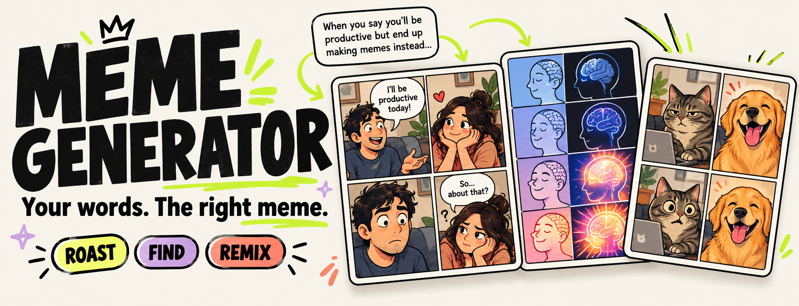
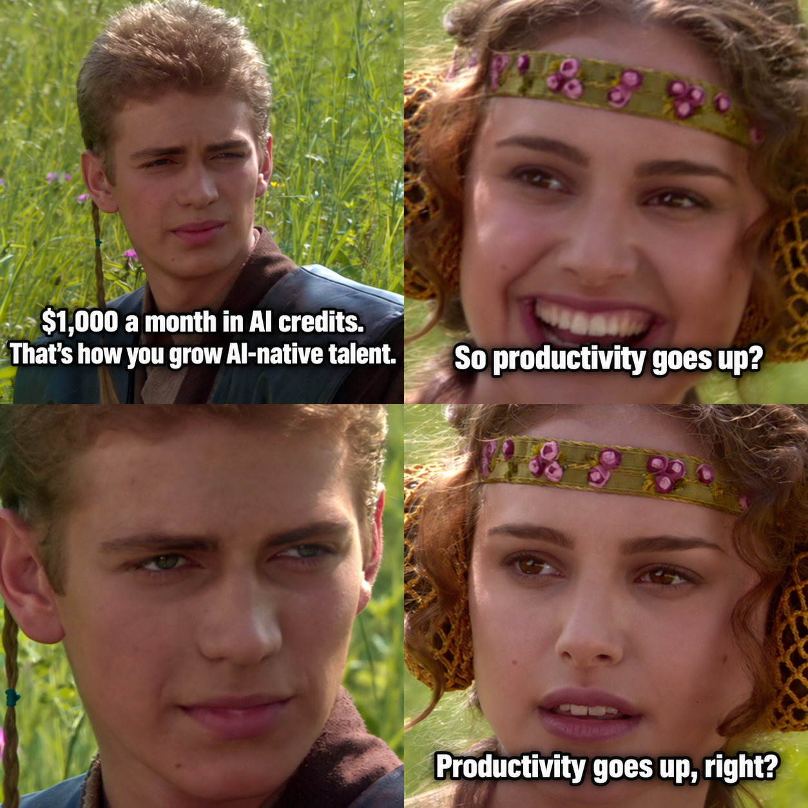
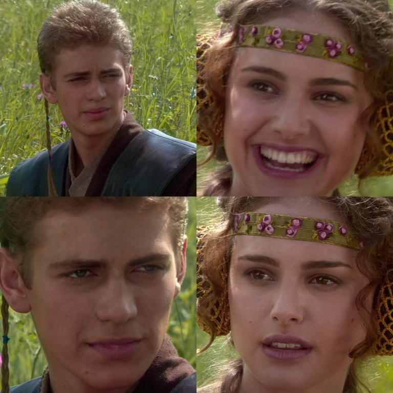
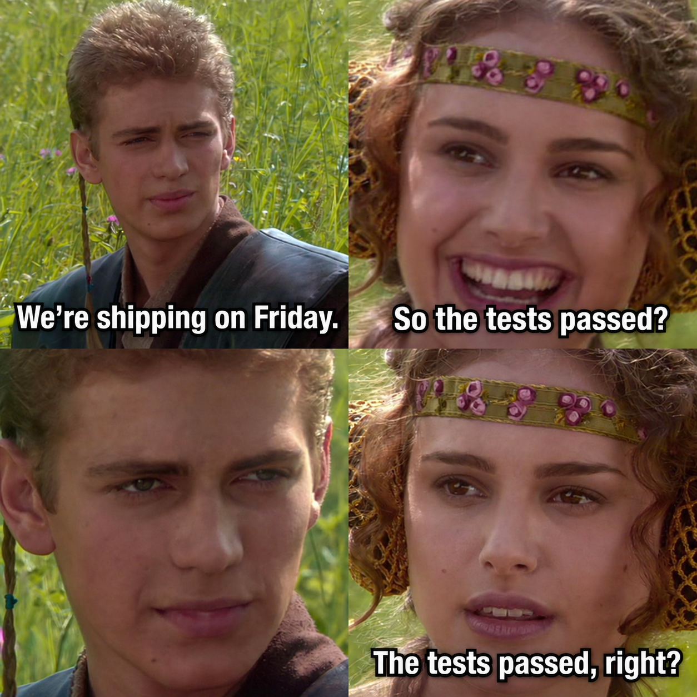
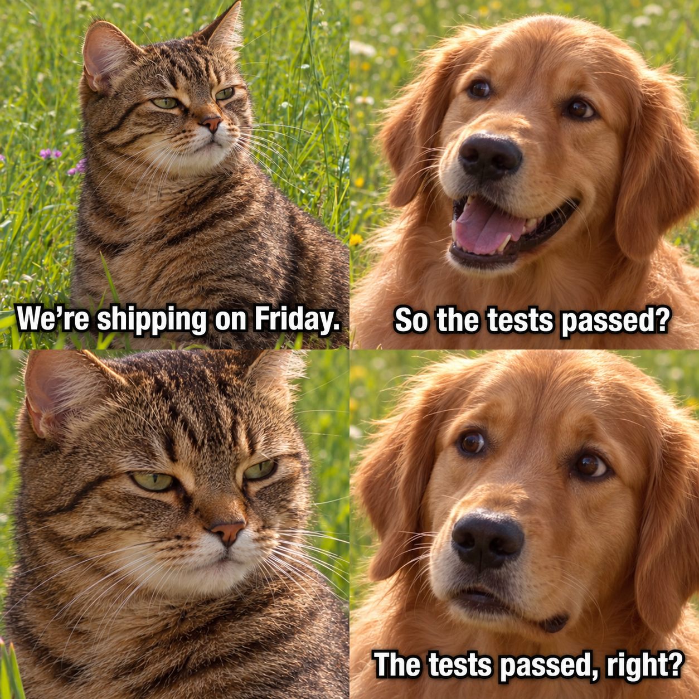
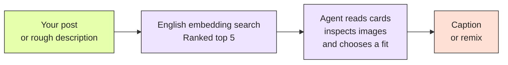

<p align="center">
  
</p>

<p align="center">
  <strong>A meme skill for your agent.</strong><br>
  Turn a post, a thought, or a half-remembered image into a fitting meme.
</p>

<p align="center">
  <a href="#1-paste-a-post-get-a-meme">Roast a post</a> ·
  <a href="#2-remember-the-scene-forget-the-name">Find a template</a> ·
  <a href="#3-same-joke-new-cast">Remix it</a> ·
  <a href="#try-it">Try it</a>
</p>

## 1. Paste a post. Get a meme.

Bring the take. Ask your agent for the reply.

> “AI-native talent needs to be raised on $200, $300, even $1,000 a month in AI credits. Let employees spend freely and they'll become smarter and more confident.”
>
> **Make a meme roasting this post.**

<p align="center">
  
</p>

The agent finds a template that fits the point you want to make, then writes captions around its roles and comic timing. Here, a confident claim meets a very reasonable follow-up question.

## 2. Remember the scene. Forget the name.

You don't need to know what a meme is called.

> **Find that four-panel meme with a man and a woman. He goes quiet while she keeps asking a question. Use it for a Friday release when nobody has confirmed the tests passed.**

<table>
  <tr>
    <th width="50%">The template your description finds</th>
    <th width="50%">Your scenario, captioned</th>
  </tr>
  <tr>
    <td></td>
    <td></td>
  </tr>
</table>

Search by the scene, the emotion, or the relationship between the characters. The agent reviews a short list of candidates and checks the actual image before choosing.

## 3. Same joke. New cast.

Keep the composition and the punchline. Change who is in the frame.

> **Use the same four panels and captions. Replace the man with a tabby cat and the woman with a golden retriever. Keep the silent close-up and the increasingly worried follow-up.**

<table>
  <tr>
    <th width="50%">Original cast</th>
    <th width="50%">Remixed cast</th>
  </tr>
  <tr>
    <td></td>
    <td></td>
  </tr>
</table>

**Character swaps and redraws require an image-generation or image-editing model connected to your agent.** The skill supplies the reference and the composition guidance; it does not bundle a generation model.

Caption-only work can use the local renderer when a reviewed layout is available. The README demo images were made with an image-generation tool; their prompts and sources are recorded in [image provenance](docs/image-provenance.json).

## The library today

A growing collection of familiar reaction images, multi-panel comics, choice templates, comparisons, and animated reactions.

| Template type | Cataloged records | Annotated and semantically searchable |
| --- | ---: | ---: |
| Still images | 500 | 26 |
| Animated templates, typically MP4 | 500 | 4 |
| **Total** | **1,000** | **30** |

**Semantic search currently covers the 30 annotated templates.** The other 970 records are drafts awaiting media inspection and English descriptions. Eight still-image templates have reviewed caption layouts. Original media is downloaded on demand.

Each annotated card explains what is in the image, how the joke works, suitable situations, character roles, caption examples, and common misuses. These descriptions make it possible to search for an idea instead of memorizing a template name.

The collection comes from public Imgflip template listings. Still images are selected from the 30-day ranking; the GIF page's ranking window is unspecified. See the [collection method and snapshot](local-meme-library/references/imgflip-collection.md).

## How the agent finds the right meme



The search step finds a small set of plausible templates. The agent makes the final creative choice after reading their descriptions and inspecting their images. It can pick any of the five, offer alternatives, or say none fits.

Requests can be written in any language your agent understands. It translates the intent into English for retrieval; captions can follow your requested language.

<details>
<summary><strong>A little more under the hood</strong></summary>

Each annotated template has separate short documents for its visual scene, joke mechanism, and individual use cases. `all-MiniLM-L6-v2` embeds those English documents and the query into normalized 384-dimensional vectors. Cosine similarity scores each view; a template takes its best view's score, and the top five unique templates are returned.

JSON cards are the editable source, SQLite stores metadata and text documents, and a NumPy index stores the vectors. Retrieval runs on your CPU after setup, with no paid embedding API or vector database service. The current index uses an exact vector scan; its memory and compute grow with the catalog.

Adding or editing an annotation only re-encodes the changed documents. Draft records stay out of semantic search. See [retrieval details](local-meme-library/references/retrieval.md) and the [card schema](local-meme-library/references/catalog.md).

</details>

## Try it

The setup script targets Linux with Bash, `uv`, and Python 3.12. Local caption rendering also needs Fontconfig or an explicit font path.

```bash
git clone git@github.com:songshikang0111/meme-generator.git
cd meme-generator
./local-meme-library/scripts/setup_embeddings.sh
```

Load [`local-meme-library/SKILL.md`](local-meme-library/SKILL.md) in your skill-compatible agent, then try:

```text
Use the local-meme-library skill to roast this post:
"More meetings are the solution to our slow delivery."
```

Setup downloads the local embedding model once. Your agent supplies the language understanding and creative judgment; character remixes additionally use its connected image tool. The built-in caption renderer handles still images. Animated templates can be found and inspected, while finished video edits require a separate video tool.

<details>
<summary><strong>Use the CLI directly</strong></summary>

```bash
# Retrieve five candidates for an English description.
./local-meme-library/scripts/meme search \
  'a four-panel conversation with an unanswered follow-up question' \
  --mode semantic --limit 5

# Read the selected template's roles, examples, and source.
./local-meme-library/scripts/meme show imgflip-322841258

# Render a template with a reviewed text layout.
./local-meme-library/scripts/meme render imgflip-181913649 \
  --text 'Fix the bug' --text 'Rewrite the framework' \
  --output /tmp/my-meme.png
```

</details>

## License and credits

Code and project-authored documentation are licensed under [MIT](LICENSE).

Source meme images and videos retain their respective owners' rights; the project's MIT license does not relicense them. Examples based on the Anakin / Padmé template reference [Imgflip template 322841258](https://imgflip.com/memetemplate/322841258). The banner and README demo outputs were generated for this project; their source references and prompts are in [image provenance](docs/image-provenance.json).
